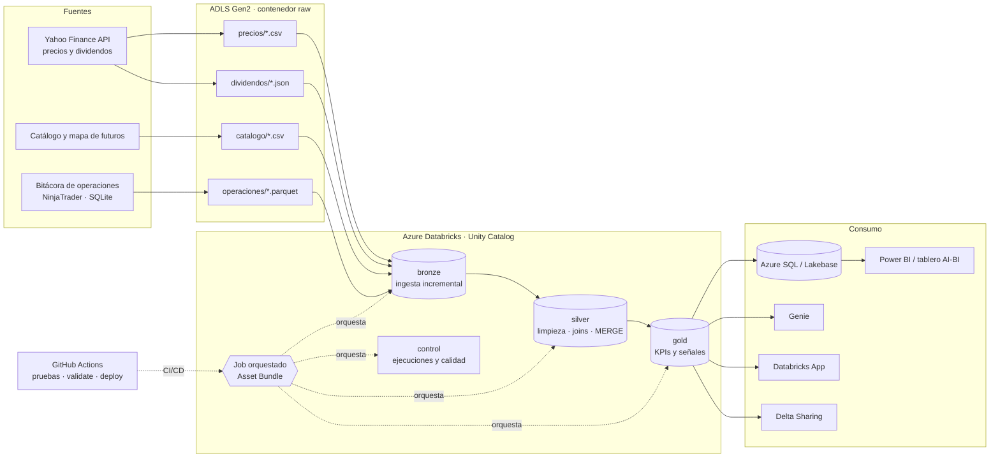

# Oracle Lakehouse · Ingeniería de datos de mercado en Azure Databricks

Lakehouse de **Oracle Investment** (gestión algorítmica de portafolios) construido con arquitectura **medallion**
en Azure Databricks. Ingiere datos de mercado y la bitácora de operaciones desde **ADLS Gen2**, los limpia y une en
PySpark, calcula **KPIs de activos, sectores y estrategias**, los gobierna con **Unity Catalog**, los comparte con
**Delta Sharing** y los sirve a una base transaccional, un tablero, **Genie** y una **Databricks App**.
Se despliega con **Databricks Asset Bundles** y **GitHub Actions**.

> Proyecto final del curso *Ingeniería de Datos e IA con Databricks* (Smart Data, G18).

## Arquitectura



## Qué resuelve
Oracle Investment opera estrategias automáticas en futuros y necesita decidir con evidencia qué estrategias mantener.
El lakehouse responde: ¿qué activos y sectores rinden mejor por unidad de riesgo?, ¿qué familias de estrategia tienen
ventaja y en qué régimen de volatilidad?, ¿qué señales dan hoy las estrategias base de tendencia y reversión?

## Datos (capa raw en ADLS, sin Volumes)

| Fuente | Formato | Contenido | Filas |
|---|---|---|---|
| `precios/` | CSV (uno por año) | OHLCV diario 2015–2026 de 33 activos + VIX + tasa a 10 años | 104.056 |
| `dividendos/` | JSON por línea | pagos de dividendos | 1.486 |
| `catalogo/catalogo_activos.csv` | CSV | ticker, nombre, tipo, sector, industria, capitalización | 35 |
| `catalogo/mapa_futuros.csv` | CSV | micro futuro CME → ETF subyacente y valor del punto | 18 |
| `operaciones/` | Parquet | bitácora de operaciones simuladas de Oracle Investment, familias anonimizadas F0–F7 | 17.169 |

Los insumos se generan con `insumos/descargar_insumos.py` y se suben a ADLS con `insumos/README.md`.

## ETL (PySpark)

| Capa | Notebook | Qué hace |
|---|---|---|
| preparación | `notebooks/00_preparacion/00_preparacion_ambiente.sql` | Ubicaciones externas por contenedor (Managed Identity), catálogo por entorno y **DDL de las 17 tablas como tablas EXTERNAS** en ADLS: si una tabla se elimina, los datos permanecen. |
| bronze | `notebooks/01_bronze/ingesta_bronze.py` | Un notebook parametrizado para las 5 fuentes (tareas en paralelo). Esquema explícito, columnas de auditoría y **carga incremental idempotente** con `_metadata` (un archivo ya ingerido no se recarga). |
| silver | `notebooks/02_silver/silver_mercado.py` | Tipado, deduplicación, rendimientos diarios, **join** con el catálogo, **MERGE** con la API Delta y `OPTIMIZE ZORDER`. |
| silver | `notebooks/02_silver/silver_operaciones.py` | **Join de tres fuentes**: operaciones + mapa de futuros + precio del subyacente y VIX → régimen de volatilidad. |
| gold | `notebooks/03_gold/gold_kpis.py` | KPIs de activo y sector por año, KPIs de estrategia por régimen y señales E1/E2; vista `panel_activos`. |
| control | `notebooks/04_calidad/controles_calidad.py` | 7 reglas de calidad; si falla una crítica, el Job no publica. |
| control | `notebooks/04_calidad/mantenimiento_delta.py` | `DESCRIBE HISTORY/DETAIL`, **time travel** (qué cambió entre versiones), OPTIMIZE ZORDER, **VACUUM** con retención por defecto, respaldo con **DEEP CLONE** (UC solo permite SHALLOW CLONE en tablas administradas) y procedimiento de **RESTORE**. |
| servir | `notebooks/05_servir/exportar_base_transaccional.py` | Copia gold a Azure SQL Database o PostgreSQL/Lakebase por JDBC con *secret scope*. |

Toda la lógica vive en `src/oracle_lakehouse/transformaciones.py` (funciones puras de PySpark) y está cubierta por
**pruebas unitarias** (`tests/`, 6 pruebas) que corren en GitHub Actions antes de cada despliegue.

### Ejecución en Azure Databricks
El Job corrió completo en Azure (dev y prod, **12/12 tareas OK**): 18 tablas externas en ADLS, ingesta idempotente
(segunda corrida = 0 filas nuevas en bronze), 7 reglas de calidad cumplidas, exportación a Azure SQL, filtro de fila y
máscara verificados por grupo, tablero publicado, Genie respondiendo y la app desplegada.
Detalle y capturas en [`docs/evidencias/`](docs/evidencias/README.md).

### Resultado de la ejecución de validación (Spark local, datos reales)
`docs/muestras/conteos_capas.json`: bronze 104.056 precios · silver 922 operaciones sin subyacente detectadas
(cripto) · gold 420 KPIs de activo-año, 264 de sector-año, 50 de estrategia y 22.619 señales.

## Orquestación y CI/CD
- **Job** `resources/job_oracle_etl.yml` (12 tareas): preparación → 5 ingestas bronze en paralelo (reintentos con espera) →
  silver → gold → calidad → mantenimiento Delta y exportación (condición `ALL_SUCCESS`). Programado de lunes a viernes a las 18:30 ET, con alerta por correo ante fallas.
- **Asset Bundle** `databricks.yml`: entornos `dev` (catálogo `oracle_dev`) y `prod` (`oracle_prd`).
- **GitHub Actions** `.github/workflows/ci_cd.yml`: pruebas → `bundle validate` → `bundle deploy` a dev en cada push a
  `main`; a prod por ejecución manual con aprobación. Sin los secretos `DATABRICKS_HOST` y `DATABRICKS_TOKEN` en el
  repositorio solo corren las pruebas (validar y desplegar quedan omitidos); el despliegue real está en `docs/evidencias/`.

## Gobierno y seguridad
- **Conexión a ADLS por Managed Identity** (Access Connector → storage credential → una external location por contenedor); comparación de métodos en `docs/conexion_adls.md`.
- `seguridad/01_grupos_y_permisos.sql`: 4 grupos con permisos por capa, **filtro de fila** y **máscara de columna** en gold.
- `seguridad/usuarios_ficticios.md`: usuarios de prueba y el procedimiento para evidenciar los permisos.
- `seguridad/02_delta_sharing.sql`: share `oracle_kpis_mercado` con un destinatario abierto; `leer_delta_sharing.py` lo consume desde fuera.

## Consumo
- `consumo/dashboard/consultas_tablero.sql`: consultas del tablero AI/BI o Power BI.
- `consumo/genie/espacio_genie.md`: configuración del espacio de Genie (instrucciones y preguntas de ejemplo).
- `consumo/app/`: Databricks App en Streamlit (panel de KPIs + autoservicio de solicitudes de acceso).

## Estructura del repositorio
```
├── databricks.yml                 bundle (dev / prod)
├── resources/                     Job del ETL
├── notebooks/                     00 preparación · 01 bronze · 02 silver · 03 gold · 04 calidad · 05 servir
├── src/oracle_lakehouse/          transformaciones PySpark reutilizables
├── tests/                         pruebas unitarias (pytest + Spark local)
├── insumos/                       generación de insumos y carga a ADLS
├── seguridad/                     grupos, permisos, usuarios ficticios y Delta Sharing
├── consumo/                       tablero, Genie y Databricks App
├── herramientas/                  ejecución local de validación
├── docs/                          arquitectura, despliegue, diccionario de datos, muestras y evidencias
└── .github/workflows/             CI/CD
```

## Cómo desplegarlo
Ver `docs/despliegue_azure.md` (recursos de Azure, Unity Catalog, carga de insumos, bundle y secretos de GitHub).

## Ejecutar las pruebas en local
```bash
pip install -r requirements-dev.txt     # requiere Java 8/11/17 y Python 3.10–3.11
pytest -q tests
python herramientas/ejecutar_local.py   # pipeline completo sobre insumos/datos
```

## Decisiones de diseño
- **Tablas externas** en todas las capas: los datos viven en contenedores propios de ADLS (`bronze`, `silver`, `gold`, `control`) y sobreviven a un `DROP TABLE`.
- **Bronze en Delta** (no Parquet): la ingesta idempotente consulta la propia tabla bronze para no recargar archivos, y Delta da historial y time travel desde la primera capa.
- **Lógica separada de los notebooks:** las transformaciones son funciones puras probadas con pytest; los notebooks solo leen, llaman y escriben.
