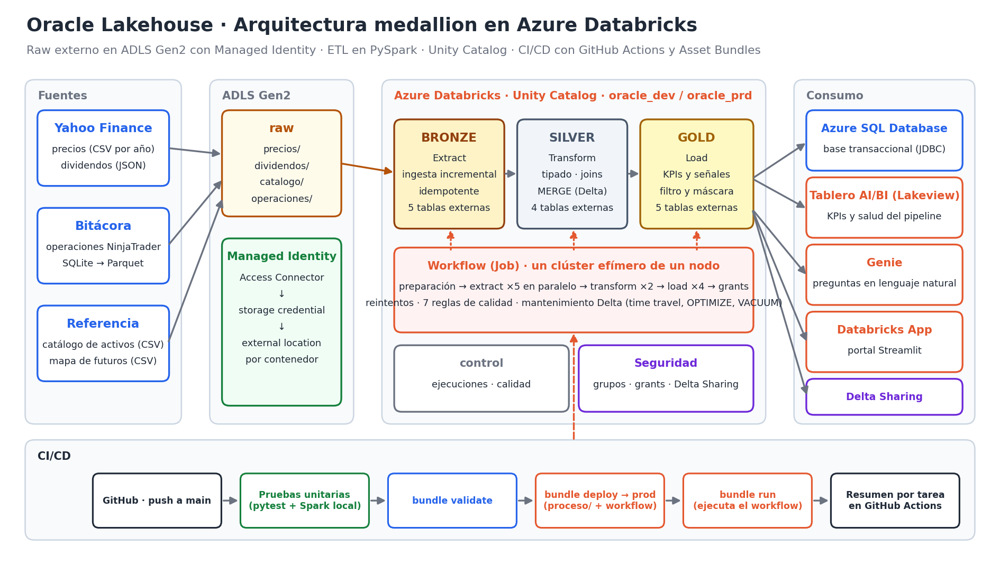

# Oracle Lakehouse · Ingeniería de datos de mercado en Azure Databricks

Lakehouse de **Oracle Investment** (gestión algorítmica de portafolios) construido con arquitectura **medallion**
en Azure Databricks. Ingiere datos de mercado y la bitácora de operaciones desde **ADLS Gen2** con **Managed Identity**,
los limpia y une en **PySpark**, calcula KPIs de activos, sectores y estrategias, los gobierna con **Unity Catalog**,
los comparte con **Delta Sharing** y los sirve a una base transaccional, un tablero, **Genie** y una **Databricks App**.
**GitHub Actions** despliega la carpeta `proceso/` en producción con **Databricks Asset Bundles** y ejecuta el workflow.

> Proyecto final del curso *Ingeniería de Datos e IA con Databricks* (Smart Data, G18).

## Arquitectura



## Qué resuelve
Oracle Investment opera estrategias automáticas en futuros y necesita decidir con evidencia qué estrategias mantener.
El lakehouse responde: ¿qué activos y sectores rinden mejor por unidad de riesgo?, ¿qué familias de estrategia tienen
ventaja y en qué régimen de volatilidad?, ¿qué señales dan hoy las estrategias base de tendencia y reversión?

## Estructura del repositorio

| Carpeta | Contenido |
|---|---|
| [`datasets/`](datasets/) | Insumos del ETL: 12 CSV de precios, 1 JSON de dividendos, 2 CSV de referencia y 1 Parquet de operaciones, más el guion que los genera. Se cargan al contenedor `raw` de ADLS. |
| [`PrepAmb/`](PrepAmb/) | Preparación del ambiente en SQL: ubicaciones externas, catálogo, esquemas y DDL de las 17 tablas externas. |
| [`proceso/`](proceso/) | **Lo único que se despliega y ejecuta en producción**: notebooks PySpark de preparación, extract, transform, load y grants, y el paquete `oracle_lakehouse` con las transformaciones. |
| [`seguridad/`](seguridad/) | Grupos, usuarios ficticios, grants por capa, filtro de fila, máscara de columna y Delta Sharing. |
| [`reversion/`](reversion/) | Elimina las tablas lógicas (`DROP`) y las rutas físicas en ADLS. |
| [`dashboard/`](dashboard/) | Tablero AI/BI (`.lvdash.json`), sus consultas, capturas `.png` y el espacio de Genie. |
| [`databricks-app/`](databricks-app/) | Databricks App en Streamlit: panel de KPIs y autoservicio de solicitudes de acceso. |
| [`.github/workflows/`](.github/workflows/ci_cd.yml) | CI/CD: pruebas → validar → desplegar en producción → ejecutar el workflow. |
| [`evidencias/`](evidencias/README.md) | Capturas de la arquitectura, el workflow, GitHub Actions, los servicios de Azure y el consumo. |
| [`certificaciones/`](certificaciones/) | Certificaciones (imagen `.png` y enlace de verificación). |
| `resources/`, `databricks.yml` | Definición del workflow y del bundle (targets `dev` y `prod`). |
| `tests/`, `herramientas/`, `docs/` | Pruebas unitarias, ejecución local y documentación (despliegue en Azure, diccionario de datos, conexión a ADLS). |

## Datos (capa raw en ADLS; no se usa DBFS ni Volumes)

| Fuente | Formato | Contenido | Filas |
|---|---|---|---|
| `precios/` | CSV (uno por año) | OHLCV diario 2015–2026 de 33 activos + VIX + tasa a 10 años | 104.056 |
| `dividendos/` | JSON por línea | pagos de dividendos | 1.486 |
| `catalogo/catalogo_activos.csv` | CSV | ticker, nombre, tipo, sector, industria, capitalización | 35 |
| `catalogo/mapa_futuros.csv` | CSV | micro futuro CME → ETF subyacente y valor del punto | 18 |
| `operaciones/` | Parquet | bitácora de operaciones simuladas de Oracle Investment, familias anonimizadas F0–F7 | 17.169 |

**Conexión a raw solo con Managed Identity:** Access Connector con rol *Storage Blob Data Contributor* → storage
credential `cred_oracle_adls` → una external location por contenedor. Sin access keys, SAS ni montajes
(`docs/conexion_adls.md`).

## El proceso (PySpark)

```
preparacion_ambiente ─► extract ×5 (en paralelo) ─► transform ×2 ─► load ×4 ─► grants
```

| Etapa | Notebook en `proceso/` | Qué hace |
|---|---|---|
| 1 · Preparación | `1_preparacion_ambiente.py` | Ubicaciones externas por contenedor, catálogo del entorno, esquemas y las **17 tablas como EXTERNAS**; verifica que ninguna quede administrada. |
| 2 · Extract | `2_extract_bronze.py` | Un notebook parametrizado para las 5 fuentes. Esquema explícito, columnas de auditoría y **carga incremental idempotente** con `_metadata`: un archivo ya ingerido no se recarga. |
| 3 · Transform | `3_transform_silver_mercado.py` | Tipado, deduplicación, rendimientos diarios, **join** con el catálogo y **MERGE** con la API de Delta. |
| 3 · Transform | `3_transform_silver_operaciones.py` | **Join de tres fuentes**: operaciones + mapa de futuros + precio del subyacente y VIX → régimen de volatilidad. |
| 4 · Load | `4_load_gold_kpis.py` | KPIs de activo y de sector por año, KPIs de estrategia por régimen y señales E1/E2. |
| 4 · Load | `4_load_controles_calidad.py` | 7 reglas de calidad en `control.calidad`; si falla una crítica, el workflow se detiene antes de exportar. |
| 4 · Load | `4_load_mantenimiento_delta.py` | Historial, **time travel**, `OPTIMIZE ZORDER`, **VACUUM** con la retención por defecto y respaldo con **DEEP CLONE**. |
| 4 · Load | `4_load_base_transaccional.py` | Copia gold a **Azure SQL Database** por JDBC; credenciales en un *secret scope*. |
| 5 · Grants | `5_grants.py` | Permisos por capa a 4 grupos, **filtro de fila** y **máscara de columna** en gold. |

Las transformaciones son funciones puras de PySpark en `proceso/oracle_lakehouse/transformaciones.py` (API de
DataFrames; no hay Spark SQL en el ETL) y están cubiertas por **pruebas unitarias** (`tests/`, 6 pruebas) que
GitHub Actions corre antes de cada despliegue. Los notebooks solo leen, llaman a esas funciones y escriben.
SQL se usa únicamente para DDL, permisos y reversión.

## CI/CD: de GitHub a producción

[`.github/workflows/ci_cd.yml`](.github/workflows/ci_cd.yml) corre en cada push a `main`:

1. **Pruebas unitarias** de las transformaciones con Spark local.
2. **`databricks bundle validate`** del bundle de producción.
3. **`databricks bundle deploy -t prod`**: sube la carpeta `proceso/` y crea o actualiza el workflow.
4. **Valida el workflow desplegado**: lista sus tareas, dependencias y clúster, y falla si alguna tarea no apunta a
   un notebook de `proceso/`.
5. Apaga cualquier clúster interactivo encendido: el workflow usa **un único clúster efímero**, que existe solo
   mientras dura la corrida de producción.
6. **`databricks bundle run`**: ejecuta el workflow completo y espera el resultado. Si una tarea falla, el job de
   Actions falla.
7. Publica en el resumen de Actions el resultado y la duración de cada tarea.

Sigue el mismo recorrido del flujo visto en clase (desplegar, crear el workflow, validarlo, ejecutarlo y
monitorearlo), pero con Asset Bundles en lugar de llamadas directas a la API: el workflow se declara en
`resources/job_oracle_etl.yml` y el bundle lo crea o actualiza sin borrarlo, así se conserva el historial de corridas.

Dev y prod comparten workspace y se aíslan por catálogo (`oracle_dev` / `oracle_prd`) y por ruta del bundle. Los
secretos del repositorio son `DATABRICKS_HOST` y `DATABRICKS_TOKEN`.

## Gobierno y seguridad
- **Tablas externas** en todas las capas, cada una en el contenedor de su capa.
- **4 grupos de cuenta** con usuarios ficticios (`seguridad/usuarios_ficticios.md`):

  | Grupo | bronze | silver | gold | control |
  |---|---|---|---|---|
  | `oi_ingenieros_datos` | ALL | ALL | ALL | ALL |
  | `oi_analistas_riesgo` | — | SELECT | SELECT | SELECT |
  | `oi_consumidores_bi` | — | — | SELECT (solo F7, sin USD neto) | — |
  | `oi_auditores` | — | — | SELECT | SELECT |

- **Delta Sharing** (`seguridad/02_delta_sharing.sql`): share `oracle_kpis_mercado` con un destinatario abierto;
  `seguridad/leer_delta_sharing.py` lo consume desde fuera de Databricks.
- **Reversión** (`reversion/`): pide confirmación explícita y nunca toca `raw`.

## Consumo
- **Base transaccional:** Azure SQL Database con las 4 tablas gold.
- **Tablero AI/BI** (`dashboard/`): KPIs de mercado, estrategias, señales vigentes y salud del pipeline.
- **Genie** (`dashboard/genie/`): espacio "Analista de mercado Oracle" sobre gold.
- **Databricks App** (`databricks-app/`): portal en Streamlit con su propio service principal de permisos mínimos.

## Ejecución en Azure
El workflow corrió completo en Azure Databricks en dev y en prod: 18 tablas externas en ADLS, ingesta idempotente
(la segunda corrida carga 0 filas en bronze), exportación a Azure SQL, filtro de fila y máscara verificados por grupo,
tablero publicado, Genie respondiendo, la app desplegada y el share leído desde fuera.
Detalle, cifras y capturas en [`evidencias/`](evidencias/README.md).

## Cómo reproducirlo
1. Recursos de Azure y Unity Catalog: `docs/despliegue_azure.md`.
2. Cargar `datasets/` al contenedor `raw`: `datasets/README.md`.
3. Configurar los secretos del repositorio y hacer push a `main`, o desplegar a mano:
   ```bash
   databricks bundle deploy -t prod
   databricks bundle run -t prod oracle_etl
   ```

Pruebas en local:
```bash
pip install -r requirements-dev.txt     # requiere Java 8/11/17 y Python 3.10–3.11
pytest -q tests
python herramientas/ejecutar_local.py   # pipeline completo sobre datasets/
```

## Decisiones de diseño
- **Tablas externas:** los datos sobreviven a un `DROP TABLE` y la reversión lógica es independiente de la física.
- **Bronze en Delta:** la ingesta idempotente consulta la propia tabla bronze para no recargar archivos, y Delta da
  historial y time travel desde la primera capa.
- **Lógica separada de los notebooks:** lo que se prueba en GitHub es exactamente lo que corre en producción.
- **Grants como última tarea:** una tabla recreada nunca queda sin control de acceso.
- **Clúster efímero de un nodo:** suficiente para el volumen y sin costo entre corridas.
