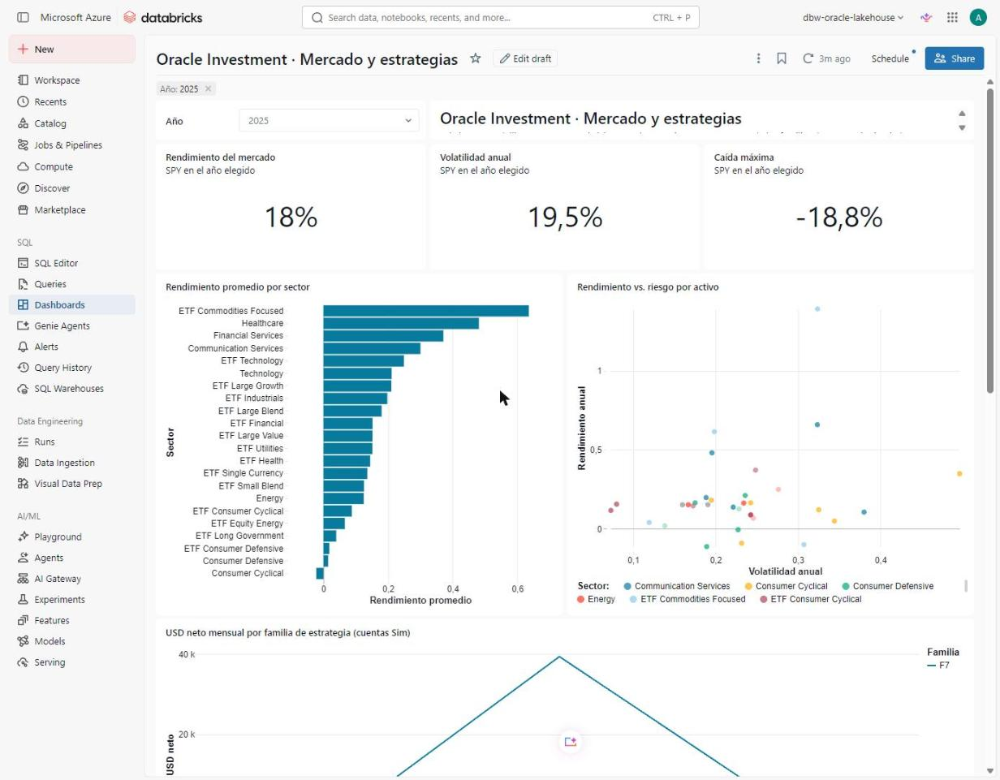
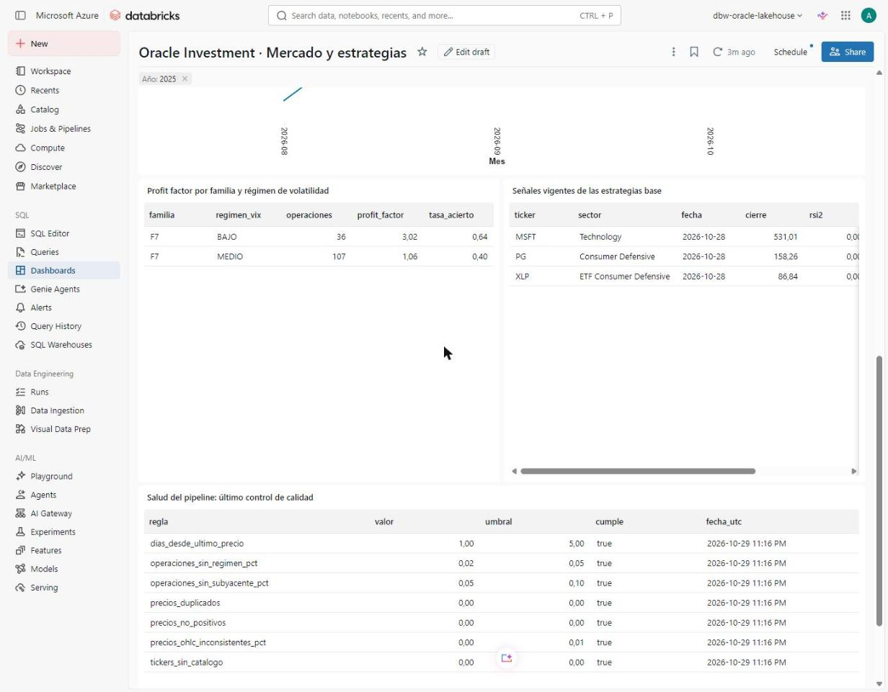

# dashboard · Tablero AI/BI y Genie

| Archivo | Qué es |
|---|---|
| `tablero_oracle.lvdash.json` | Definición del tablero AI/BI (Lakeview); se importa desde *Dashboards → Import dashboard from file*. |
| `generar_tablero.py` | Genera el `.lvdash.json` para un catálogo: `python dashboard/generar_tablero.py oracle_prd`. |
| `consultas_tablero.sql` | Las consultas del tablero sobre la capa gold y `control`. |
| `tablero_kpis_mercado.png` | Página 1: tarjetas del mercado, rendimiento por sector y rendimiento frente a riesgo. |
| `tablero_tablas_y_calidad.png` | Página 2: estrategias por régimen, señales vigentes y salud del pipeline. |
| `enlace.txt` | Enlace al tablero publicado en el workspace. |
| `genie/` | Espacio de Genie "Analista de mercado Oracle": instrucciones, preguntas de ejemplo y guion de creación. |

